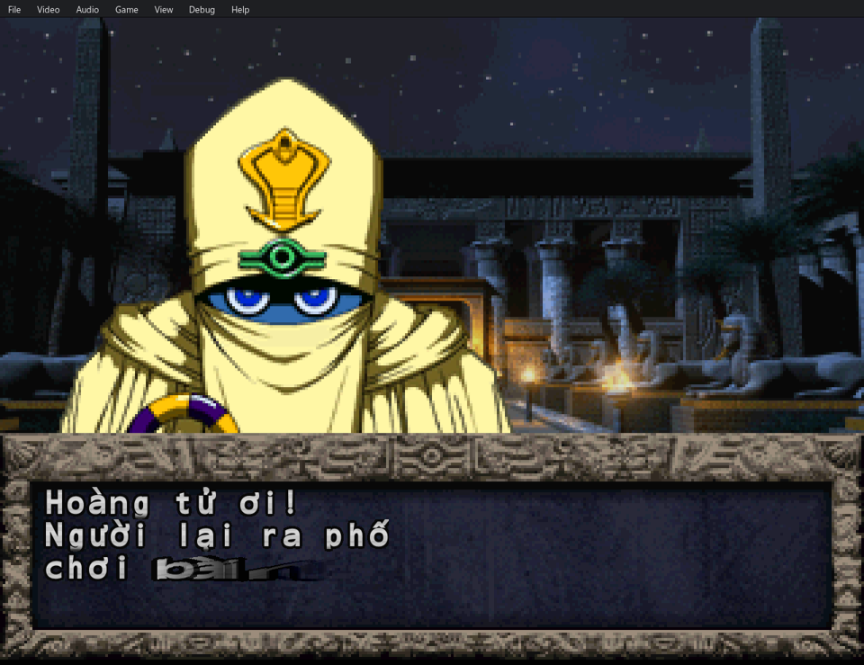
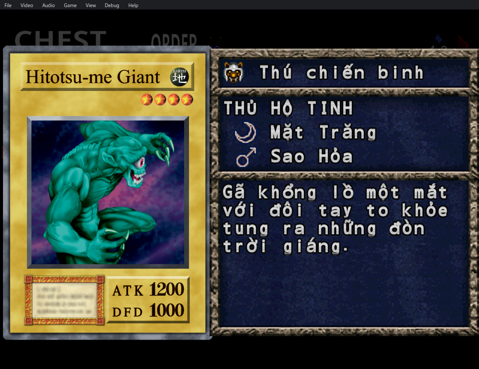
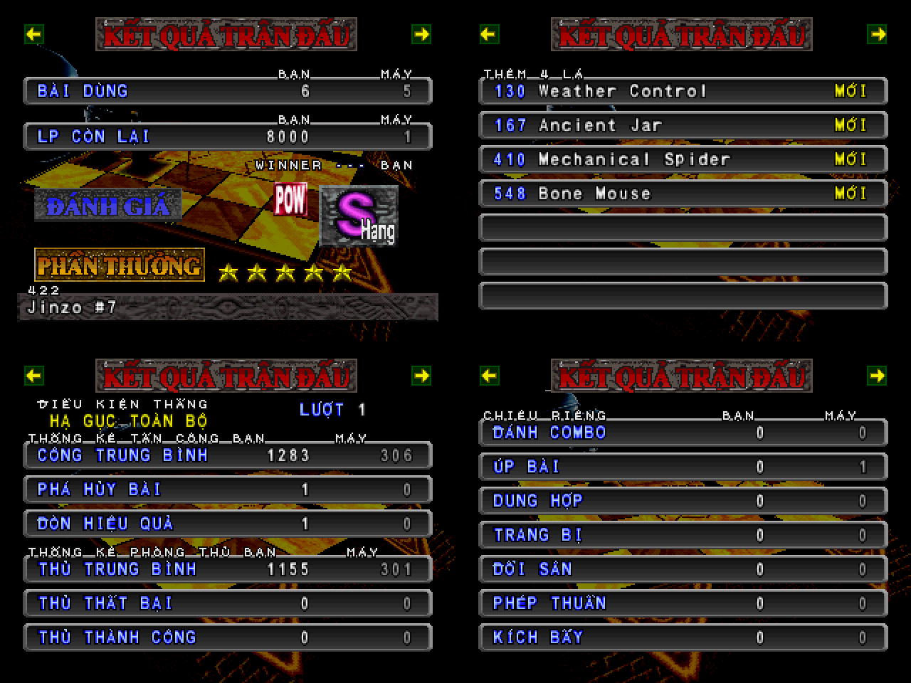
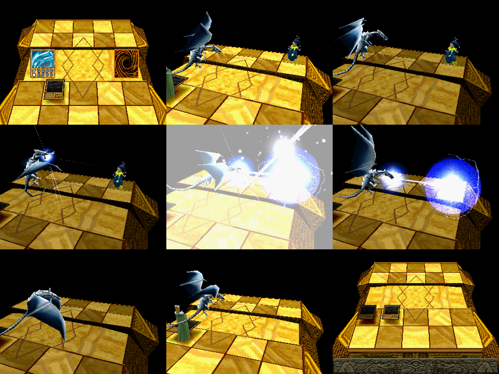
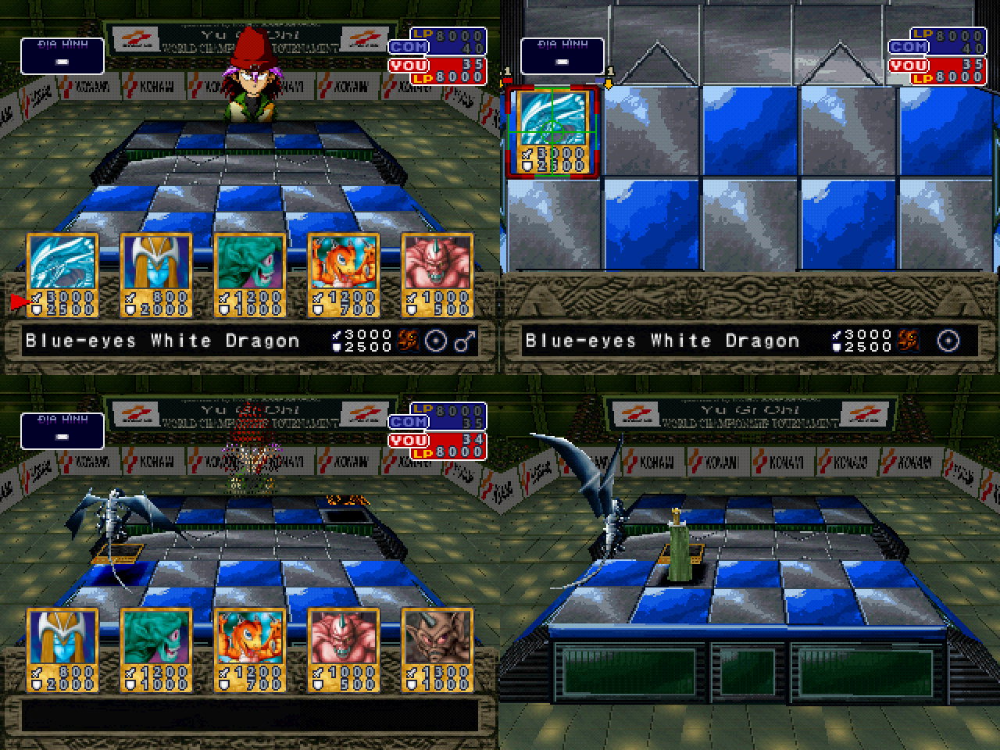

# Yu-Gi-Oh! Forbidden Memories Recompiled — Việt hoá (PC + Android)

Một gói mod tiếng Việt cho [Yu-Gi-Oh! Forbidden Memories Recompiled](https://github.com/Unchiga/Yu-Gi-Oh-Forbidden-Memories-Recompiled)
(bản PC/Android dựng từ mã nguồn giải mã của game PS1). Dùng **bản chính thức v0.3.0** của port cho cả Windows và
Android, chỉ cần thêm **một file zip** mod. Bản dịch lấy từ bản Việt hoá đĩa
[yugioh-fm-vi-patch](https://github.com/2ez4gcx/yugioh-fm-vi-patch).

**Không kèm dữ liệu game.** File game gốc do người chơi tự cung cấp (xem [File game gốc](#file-game-gốc-người-chơi-tự-cung-cấp)).

## File game gốc (người chơi tự cung cấp)

Repo và các file ở Releases **không chứa** file game: không có đĩa, không có EXE `SLUS_014.11`, không có hình, nhạc
hay thoại gốc của game. Game chạy từ chính file đĩa của bạn, đọc trực tiếp lúc chơi. Các mod ở đây chỉ chứa phần
dịch, phần vẽ lại và các bảng chỉnh sửa.

Bạn cần:

| | |
|---|---|
| Game | Yu-Gi-Oh! Forbidden Memories, bản **Mỹ (USA)**, mã **SLUS-01411** |
| Định dạng | file **`.bin`** dạng thô (một track, MODE2/2352), tên file đặt tùy ý. Không dùng `.iso`, `.chd`, `.cue` thay cho `.bin` (file `.cue` không cần) |
| Kích thước | 517.872.768 byte |
| SHA-256 đĩa chuẩn | `6e22494a45bf50fa2d239cd3819a57163a5f9b91e0365babc3e101509b5c3a7c` |

- Dùng **đĩa gốc chưa vá**: không dùng file đã áp bản vá Việt hoá đĩa (`yugioh-fm-vi.ppf`) hay bản vá khác, vì port
  đọc dữ liệu thẳng từ đĩa và bản dịch của port là mod riêng. Bản châu Âu (PAL) hay Nhật không chạy được.
- Lấy file từ **đĩa game của chính bạn** bằng phần mềm chép đĩa ra BIN/CUE (sector thô 2352 byte). Đừng hỏi hay
  chia sẻ link tải file game trong repo này.
- Kiểm tra file trên Windows: `certutil -hashfile "tên-file.bin" SHA256` (PowerShell: `Get-FileHash "tên-file.bin"`).
  Mã khác mã ở trên thường là file đã vá, bản khác vùng, hoặc file chép lỗi.

Đặt file ở đâu:

- **Android:** chép file `.bin` vào điện thoại (ví dụ thư mục Download). Lần đầu mở app, chọn **Choose disc image...**
  rồi chọn file. App tự chép vào bộ nhớ của nó (`Android/data/org.yfmredecomp.game/files/game/`), lần sau không
  cần chọn lại; có thể xoá bản ở Download sau khi app đã chép xong.
- **PC (bản chính thức):** lần đầu chạy `memories-pc.exe`, chọn file `.bin` trong hộp thoại.
- **PC (build từ mã nguồn):** đặt file `.bin` vào thư mục `game\` của mã nguồn rồi chạy `play.bat`.

## Tải về

| File | Lấy ở |
|---|---|
| Game bản chính thức v0.3.0: `yfm-redecomp-v0.3.0-android-arm64.apk` (Android) hoặc `yfm-redecomp-v0.3.0-windows.zip` (Windows) | [release v0.3.0 của port](https://github.com/Unchiga/Yu-Gi-Oh-Forbidden-Memories-Recompiled/releases/tag/v0.3.0) |
| Gói HD (tuỳ chọn): `yfm-redecomp-hd-mod-v0.3.0.zip`; trên Android tải trong app bằng Mods > HD pack... | release v0.3.0 của port |
| **Gói mod Việt hoá**: `yfm-viet-hoa-mods-v<phiên bản>.zip`, dùng chung cho Windows và Android | [Releases](../../releases) của repo này |

Mã SHA-256 của gói mod nằm trong `SHA256SUMS.txt` của release.

## Có gì trong gói mod

| Mod | Tác giả | Làm gì |
|---|---|---|
| Tiếng Việt (`viet-hoa`) | bản Việt hoá này | toàn bộ cốt truyện, menu, thẻ nhớ, 722 mô tả lá bài, loại bài, thủ hộ tinh, tên người, địa danh; tên lá bài giữ tiếng Anh |
| Tiếng Việt: đồ hoạ (`viet-hoa-gfx`) | bản Việt hoá này | BẤM NÚT START và dòng ghi công, menu tiêu đề và trong game, banner ĐẤU TỰ DO, CHÚ Ý!, ô ĐỊA HÌNH và tên địa hình, màn kết quả, tiêu đề CÀI ĐẶT, nhãn MỚI! |
| Đủ 722 lá (`du-722-la`) | bản Việt hoá này | 82 lá vốn không rơi được thêm vào bảng rơi S/A của đối thủ dùng lá đó, 122 lá giá 999999 sao được hạ giá theo cấp, 24 lá không có mật mã được thêm mật mã thật |
| Rơi nhiều lá (`roi-nhieu-la`) | bản Việt hoá này | mỗi trận thắng 5 lá (đổi số lá trong tuỳ chọn của mod) |
| Monster Effects – tiếng Việt (`monster-effects-vi`) | bản Việt hoá này | mô tả hiệu ứng tiếng Việt cho 63 lá của Monster Effects |
| Monster Effects | jonasfelix92 | 61 quái vật có hiệu ứng, mở rộng Dark Hole và Harpie's Feather Duster |
| Adversários à Mesa (`simon-at-table`) | jonasfelix92 | đối thủ ngồi sau bàn đấu, chớp mắt và đổi nét mặt theo điểm sinh mệnh |
| 3D Duel Arena | jonasfelix92 | cảnh 3D quanh bàn đấu; sân vận động ở giải đấu trong cốt truyện (đối thủ 9 đến 17) |
| Dual Play, AI Hard Mode 0.1.10 | jonasfelix92 | tuỳ chọn, tắt sẵn |

Mod code trong gói có cả bản Windows (i386) và Android (arm64), build cho game v0.3.0.

| | |
|---|---|
|  |  |
|  |  |

## Cài trên Android

1. Cài `yfm-redecomp-v0.3.0-android-arm64.apk` (Android 7.0 trở lên, máy arm64), mở app, chọn **Choose disc image...**
   và chọn file `.bin`.
2. **Mods > HD pack...** để tải gói HD (tuỳ chọn).
3. **Mods > Import mod...**, chọn `yfm-viet-hoa-mods-v<phiên bản>.zip`. Mod nhập vào đều đang tắt: bật
   **Tiếng Việt, Tiếng Việt: đồ hoạ, Đủ 722 lá, Rơi nhiều lá, Monster Effects, Monster Effects – tiếng Việt,
   Adversários à Mesa, 3D Duel Arena**.
4. **Mods > 3D Monsters > Monsters attack = On the field**: quái vật đánh thẳng trên bàn, không vào cảnh hai lá bài lớn.
5. **Apply** rồi mở lại app. Tuỳ chọn: Video > Internal 4x và HD text (máy yếu thì 2x).

## Cài trên Windows

1. Giải nén `yfm-redecomp-v0.3.0-windows.zip`, chạy `memories-pc.exe`, chọn file `.bin`.
2. Gói HD (tuỳ chọn): giải nén `yfm-redecomp-hd-mod-v0.3.0.zip` vào thư mục game (cạnh `memories-pc.exe`).
3. Đóng game. Giải nén `yfm-viet-hoa-mods-v<phiên bản>.zip` vào `Documents\My Games\YFM Re-Decomp`
   (thành `...\YFM Re-Decomp\mods\viet-hoa`, ...). Các mod tự bật, trừ Dual Play và AI Hard Mode.
4. Mở game, **F10 > Game > Mods > 3D Monsters > Monsters attack = On the field**, Apply.
   Video > Resolution > Internal 4x và Video > HD text.

Cập nhật lên gói mod mới: làm lại bước 3 (Android) hoặc giải nén đè (Windows).

## Save cũ

Save thẻ nhớ từ giả lập (`.mcr`, `.mcd`, `.srm`, `.gme`, `.mcs`, `.psv`...) hay từ bản Việt hoá đĩa: chép vào thư mục
`saves` (Windows: `Documents\My Games\YFM Re-Decomp\saves`; Android: `Android/data/org.yfmredecomp.game/files/saves`)
rồi chọn LOAD ở màn tiêu đề. Tên nhân vật có dấu tiếng Việt từ bản đĩa sẽ hiện sai chữ (bảng mã khác).
Save state (F5/F7, hay của giả lập) không chuyển được giữa máy và phiên bản: lưu trong game trước khi chuyển.

## Lưu ý

- Gói mod đã chạy đúng trên bản Windows build từ mã v0.3.0 (cùng mã với APK): chữ và đồ hoạ tiếng Việt, đánh
  trên bàn, rơi 5 lá, sân vận động. Bản Android của các mod jonasfelix92 tác giả ghi là chưa thử trên máy thật.
- Font của port rộng cố định 8 px (bản đĩa dùng chữ rộng thay đổi), nên vài chỗ được ngắt dòng lại hoặc xếp lại cho
  vừa ô: mô tả lá bài, vài câu thoại dài, tên "Thung Lũng Vua" trên bản đồ (ô 16 chữ), menu chọn thủ hộ tinh
  (lựa chọn sát lề trái để "Sao Thiên Vương" vừa khung, kể cả chữ HD trên Android).
- Chỉ dùng bản Việt hoá này: đừng bật cùng một bản dịch tiếng Việt khác (port từ chối bộ mod có hai bản dịch xung đột).

## Đóng gói lại

`python make_bundle.py --version <phiên bản> --out <thư mục>` gom `mods/` của repo này với mod của tác giả khác (từ thư
mục mod của người chơi) thành một file zip. Mod code phải build bằng `tools/pc/build_mod.py` của port **v0.3.0**
(API 12): bản API mới hơn bị game v0.3.0 từ chối.

## Ghi công và giấy phép

- Port Yu-Gi-Oh! Forbidden Memories Recompiled: Unchiga và cộng sự (phần port: MIT). Giải mã gốc:
  [memories-decomp](https://github.com/krystalgamer/memories-decomp). Yu-Gi-Oh! và Forbidden Memories thuộc Konami.
- Gói Forbidden Memories HD: Unchiga, X@nder (tải ở release của port, không nằm trong gói này).
- Mod của **jonasfelix92**, chia sẻ công khai trên [Discord YFM Re-Decomp](https://discord.gg/Gn6Mag52q):

  | Mod | Phiên bản |
  |---|---|
  | Monster Effects | 0.37.1 |
  | Adversários à Mesa (`simon-at-table`) | 0.5.0 |
  | 3D Duel Arena | 0.6.2 |
  | Dual Play | 0.5.10 |
  | AI Hard Mode (bản dùng cùng Monster Effects; AI Hard Mode gốc của DecompRecomp, MIT) | 0.1.10 |

  Các mod này được gói lại **nguyên vẹn**, không sửa đổi, kèm mã nguồn, tài liệu và giấy phép của tác giả trong thư
  mục từng mod. Bản quyền thuộc tác giả. `monster-effects-vi` chỉ thêm bản dịch tiếng Việt các mô tả hiệu ứng của
  Monster Effects, không đổi mod gốc.
- Bản Việt hoá (chữ, đồ hoạ, mô tả hiệu ứng), Đủ 722 lá, Rơi nhiều lá: Bản Việt hóa phi lợi nhuận bởi KhươngKid.

Gói mod phát hành **phi lợi nhuận**, miễn phí, để người chơi cài đặt thuận tiện. Không bán và không dùng vào mục đích
thương mại. Tác giả nào muốn gỡ phần của mình khỏi gói, hoặc muốn ghi công khác đi, xin mở issue ở repo này: phần đó
sẽ được gỡ hoặc sửa ngay.
